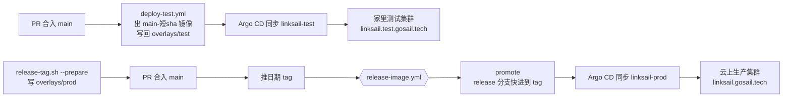

# LinkSail 运维

本文件记录 LinkSail（本仓 new-api 的部署名）在 GoSail 集群上的部署位置、发布与回滚做法；上游通用安装说明不在这里重复。日期 tag 的格式、发布脚本的各个参数、哪些上游 workflow 已停用，见 [git.md](git.md)。集群、共享 PG 与 Redis、Argo CD、入口这些各服务共用的环境，见 GoSail 工作空间仓的 `fleet-doc/ops.md`，这里不重复；集群拓扑与「Git 里写什么、线上就跑什么」的发布方式为什么这样定，见同仓的 `fleet-doc/adr/0005-k8s-single-prod-cluster.md`。

## 部署在哪

| 环境 | 集群（kubeconfig 里的 context 名） | 命名空间 | Argo CD 应用名 | 跟本仓哪个分支 |
| --- | --- | --- | --- | --- |
| 测试 | 家里的测试集群（`gosail-test`） | `linksail` | `linksail-test` | `main` |
| 生产 | 云上的生产集群（`gosail-prod`） | `linksail` | `linksail-prod` | `release` |

Argo CD 是装在生产集群里的部署工具，同时管着两个集群。它的每个「应用」（Application）记着一件事：从哪个仓、哪个分支、哪个目录取部署清单，部署到哪个集群的哪个命名空间；分支上的清单一变，它就把集群改成清单写的样子。这两个应用的定义不在本仓，在 GoSail 工作空间仓的 `deploy/k8s/apps/overlays/test/services.yaml` 与 `deploy/k8s/apps/overlays/prod/services.yaml`。

两个应用都开着自动同步和自我修复：用 `kubectl edit`、`kubectl scale` 在集群里直接改的东西，会被 Argo CD 改回 Git 里的样子。要改部署，就改本仓 `deploy/` 下的文件并合进对应分支。



## 配置在本仓哪里

部署清单按 kustomize 的写法分层：`base` 放两个环境共用的清单，`overlays/<环境>` 引用 `base`，只写这个环境不同的地方。

| 路径 | 管什么 |
| --- | --- |
| `deploy/k8s/linksail/base/` | 两个环境共用：Deployment（镜像名、端口、探针、资源上限、凭证与连接串怎么拼）、Service、Ingress（生产域名） |
| `deploy/k8s/linksail/overlays/test/` | 测试环境：镜像版本、库名、Redis 库号、测试域名 |
| `deploy/k8s/linksail/overlays/prod/` | 生产环境：镜像版本、库名、Redis 库号、只调度到国内区域的节点 |
| `deploy/secrets-map.yaml` | 机密对照表，见〈机密〉 |

端口、资源、库名、Redis 库号、镜像版本都以上面的文件为准，本文不抄。想看某个环境最终交给集群的完整清单，在仓根运行：

```bash
kubectl kustomize deploy/k8s/linksail/overlays/prod
```

两个环境的镜像版本都由脚本写，不手改：`overlays/test` 由 `deploy-test.yml` 在合并到 main 后写入，`overlays/prod` 由 `scripts/release-tag.sh --prepare` 在打 tag 前写入。唯一的例外是〈回滚〉里测试环境那一种做法。

普通环境变量写在 `base/deployment.yaml`（两个环境相同的）和各 overlay 的 `configMapGenerator`（随环境变的）里。kustomize 会给生成的 ConfigMap 名字加上内容哈希，所以改了 overlay 里的值，合进去之后服务会自动重启并读到新值。

## 机密

凭证的值只存在本机 `settings.local.json`（默认路径 `~/.agents/settings.local.json`）的 `env` 下，Git 里只有键名。`deploy/secrets-map.yaml` 是对照表：集群里每个 Secret 的每个键，对应 settings 里哪个键。现在有这几个 Secret，键名以对照表为准：

| Secret（命名空间） | 用途 |
| --- | --- |
| `linksail-secrets`（`linksail`） | 库密码、Redis 密码、`SESSION_SECRET`、`CRYPTO_SECRET`。测试与生产各一套 |
| `pg-cn-role-newapi-test` / `pg-cn-role-newapi-prod`（`data-cn`） | 数据库账号的密码，CloudNativePG（集群里管 PG 的组件）按它建账号；值与对应环境的库密码是同一个 settings 键 |

库密码和 Redis 密码会原样拼进连接串，所以 settings 里这两类值只用字母和数字（原因写在 `base/deployment.yaml` 的注释里）。

推进集群用 GoSail 工作空间仓的脚本，在**工作空间仓根目录**运行：

```bash
# 先看会写哪些 Secret、哪些键（不打印值）
node deploy/scripts/secrets.js push --cluster test --map project/new-api/deploy/secrets-map.yaml --dry-run
# 推测试集群 / 生产集群
node deploy/scripts/secrets.js push --cluster test --map project/new-api/deploy/secrets-map.yaml
node deploy/scripts/secrets.js push --cluster prod --map project/new-api/deploy/secrets-map.yaml
# 核对集群里的值与 settings 是否一致，只报一致与否
node deploy/scripts/secrets.js diff --cluster prod --map project/new-api/deploy/secrets-map.yaml
```

脚本默认用 kubeconfig 里名为 `gosail-test` / `gosail-prod` 的 context，名字不同时加 `--context <名字>`。settings 里缺键时脚本只报键名并停下。

两点要知道：

- **Argo CD 不管 Secret 的值。** 新增或修改凭证都要手动推一次。
- **改了凭证，服务不会自己重启。** 凭证在容器启动时读进环境变量，推完要重启一次：`kubectl --context gosail-prod -n linksail rollout restart deploy/linksail`。

`CRYPTO_SECRET` 用来加解密库里的敏感字段，生产环境换了它，已经存进库的值就解不开了。

## 发测试版

把改动合进 `main` 就会发测试版，不用敲命令：

1. `deploy-test.yml` 在 push 到 `main` 时构建 `hubwu42/new-api:main-<短 sha>`（只出 amd64，测试集群只有 amd64 节点），镜像里的版本号就是 `main-<短 sha>`。
2. 它把这个版本写进 `deploy/k8s/linksail/overlays/test/kustomization.yaml`，以 `github-actions[bot]` 的身份提交回 `main`（提交信息带 `[skip ci]`，不会再触发自己）。
3. 再调 Argo CD 的 webhook，`linksail-test` 立刻同步。仓库 secret `ARGOCD_WEBHOOK_SECRET` 缺了也不丢部署，Argo CD 每 3 分钟自己轮询一次 Git。

这次 push 只改了 `overlays/test` 时不构建、不改写，用于〈回滚〉里的测试环境回退。

## 发正式版

镜像仓库 `hubwu42/new-api`，正式版出 `linux/amd64` 与 `linux/arm64` 两个架构。Git tag `v2026.10.8-r1` 对应镜像 `hubwu42/new-api:2026.10.8-r1`，同一次构建另刷一个 `latest`，`latest` 只给人手动拉取用，集群只认 overlay 里钉的日期版本。

1. 在一条 `feat/GS-<n>-…` 分支上写好生产版本号，经 PR 合进 `main`：

   ```bash
   git switch main && git pull
   bash scripts/release-tag.sh --dry       # 只看下一版的 tag 是什么，不改任何东西
   bash scripts/release-tag.sh --prepare   # 把下一版的镜像 tag 写进 deploy/k8s/linksail/overlays/prod
   # 提交这个改动，开 PR，合入 main
   ```

   跨过北京时间零点会让 `--prepare` 算出的日期过期，此时重新 `--prepare`。

2. 合入后在 `main` 上打 tag 并推送。**推正式 tag 就是上线确认**，生产没有其他人工审批，推之前由人确认：

   ```bash
   git switch main && git pull
   bash scripts/release-tag.sh             # 在本地打当天的 tag；overlays/prod 钉的不是这个版本时拒绝
   git push origin v2026.10.8-r1           # 填脚本输出的 tag；只推这一个，不用 --tags
   ```

3. `release-image.yml` 接着自己跑完：

   | job | 干什么 |
   | --- | --- |
   | `verify` | `release-tag.sh --check` 校验 tag 的形状与时序；tag 必须在 `main` 上；`overlays/prod` 钉的必须就是这一版，否则在构建前停下 |
   | `build` | 两个架构各构建一次。构建前把发布标识写进仓库根的 `VERSION`，Go 的 `-X common.Version` 与前端 `VITE_REACT_APP_VERSION` 都读它 |
   | `manifest` | 合成多架构的日期 tag，正式版另刷 `latest`；再在镜像里搜一遍发布标识，搜不到就整条失败 |
   | `promote` | 把 `release` 分支快进到 tag 所在提交，调 Argo CD 的 webhook；`linksail-prod` 随即部署 `overlays/prod` 里钉的版本 |

`promote` 只快进、不强推：`release` 上要是有不在这个 tag 历史里的提交，推送会被拒、job 变红，等人来看。

**干跑**：`v2026.10.8-r1-dry.1` 这种带 `-dry.N` 的 tag 会构建并推送 `hubwu42/new-api:2026.10.8-r1-dry.1`，不刷 `latest`、不动 `release` 分支，生产不变。推干跑 tag 会消耗 CI 与镜像仓资源，同样先确认；本地 `bash scripts/release-tag.sh --dry` 完全不发布。

上线后核对：`curl -s https://linksail.gosail.tech/api/status` 返回的 `version` 应当等于发布标识（去掉前导 `v`）。

## 看部署状态

Argo CD 只装在生产集群里，两个环境的应用都在生产集群的 `argocd` 命名空间里看：

```bash
kubectl --context gosail-prod -n argocd get application linksail-test linksail-prod
```

`SYNC STATUS` 为 `Synced`、`HEALTH STATUS` 为 `Healthy` 就是上线完成。还想细看：

```bash
# 生产实际在跑的镜像、滚动进度、日志
kubectl --context gosail-prod -n linksail get deploy linksail -o jsonpath='{.spec.template.spec.containers[0].image}{"\n"}'
kubectl --context gosail-prod -n linksail rollout status deploy/linksail
kubectl --context gosail-prod -n linksail logs deploy/linksail --tail=100
# 测试环境的 Pod 在家里测试集群
kubectl --context gosail-test -n linksail get pods
# 不想等 3 分钟的轮询，让 Argo CD 立刻重新读 Git
kubectl --context gosail-prod -n argocd annotate application linksail-prod argocd.argoproj.io/refresh=normal --overwrite
```

也可以开 Argo CD 网页 <https://argocd-ui.gosail.tech>：只有连着 Tailscale 的设备能打开，用户名 `admin`，密码在 settings 的 `GOSAIL_ARGOCD_ADMIN_PASSWORD`。

每次上线服务会短暂中断：Deployment 用 `Recreate`，先停旧的再起新的，避免两份同时做主节点、重复跑定时任务（原因写在 `base/deployment.yaml` 的注释里）。新版本启动时自动迁移表结构，迁移只往前走。

## 回滚

### 测试环境

测试环境跟 `main` 上的 `overlays/test`，两种做法：

- **把出问题的改动 revert 掉**：开 PR revert，合入后自动发新的测试版。
- **直接退回某个旧的测试版镜像**：`git log -p deploy/k8s/linksail/overlays/test/kustomization.yaml` 找到上一个正常的 `main-<短 sha>`，开 PR 把 `newTag` 改回它，合入。`deploy-test.yml` 看到只改了 `overlays/test`，不构建也不发 webhook，Argo CD 在 3 分钟内轮询到（或用上面的 annotate 命令立刻刷新）。下一次有代码合进 `main`，测试环境会照常换成新构建的版本。

### 生产环境

已经用过的 tag 不能复用，日期与序号不能倒退，`verify` 又要求 tag 与 `overlays/prod` 钉的版本一致，所以没法给旧版本再打一个 tag。生产回滚有两种做法，都是生产操作，由人确认目标版本后再动手：

**常规做法：修好或 revert 之后发一个新版本。** 在 `main` 上 revert 出问题的改动，按〈发正式版〉用新的发布标识再发一次，镜像从 revert 之后的代码重新构建。

**紧急做法：把 `release` 分支指回上一个正式版本的提交。** 生产跟的是 `release` 分支，上一个 tag 的提交里 `overlays/prod` 钉的就是上一版镜像，它还在 Docker Hub 上（已发布的日期 tag 不覆盖、不删除），不需要重新构建：

```bash
prev=v2026.10.8-r1                       # 上一个正常的正式版本
sha=$(git rev-parse "$prev^{commit}")
gh api -X PATCH repos/HubWu42/new-api/git/refs/heads/release -f sha="$sha" -F force=true
kubectl --context gosail-prod -n argocd annotate application linksail-prod argocd.argoproj.io/refresh=normal --overwrite
```

退回之后：

- `main` 上的问题还在。修好之后照常发下一个版本：上一版的提交是新 tag 的祖先，`promote` 仍然能快进。
- 新版本启动时已经迁移过表结构的，旧版本会跑在新表结构上。退回前先看两个版本之间 `model/` 里的表结构有没有变化，旧版本不能接受时只走常规做法。
- 等 Argo CD 显示 `Synced` / `Healthy` 之后，核对 `/api/status` 的 `version` 已是上一版。

## 访问地址

域名以 `deploy/k8s/linksail/base/ingress.yaml`（生产）和 `overlays/test/kustomization.yaml` 里的 patch（测试）为准：

| 环境 | 地址 | 怎么访问 |
| --- | --- | --- |
| 测试 | <https://linksail.test.gosail.tech> | 只有连着 Tailscale 的设备能访问：`*.test.gosail.tech` 解析到家里测试节点的 Tailscale 地址 |
| 生产 | <https://linksail.gosail.tech> | 公网；Cloudflare 灰云（只做解析、不经它的代理），直连国内入口 |

大请求体（长会话、带工具结果）被掐断的问题出在入口 Traefik 的读超时，那是全站设置，归 GoSail 工作空间仓的 `deploy/k8s/traefik` 管，本仓不处理。
